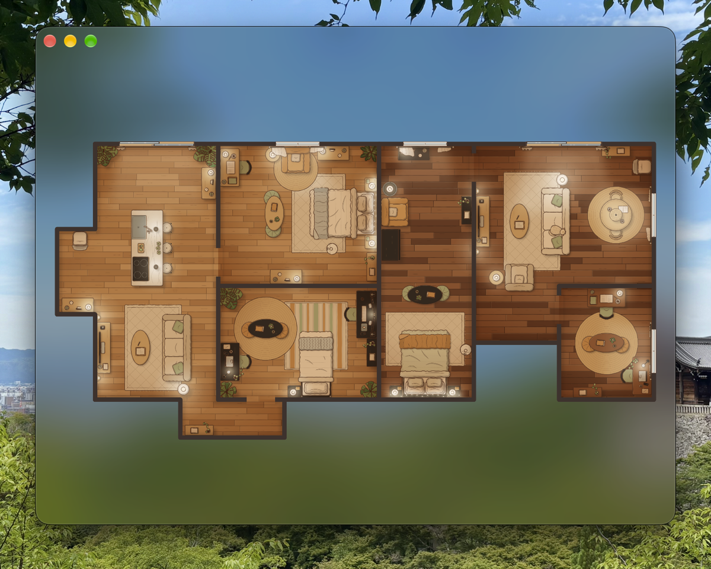

# Robovac

A macOS app that shows each running `/robovac` session as a robot vacuum in a top-down house. Each
session gets its own suite of three rooms, with its own robot and dock, up to nine at once.

<p align="center">
  
</p>

## Build and run

You need macOS 13 or later and Apple's Command Line Tools (`xcode-select --install`).

```bash
mac/build.sh
open ~/Applications/Robovac.app
```

`build.sh` compiles the app on your Mac, downloads the house images from this repository's release
if they aren't current, and installs the app in `~/Applications`, so it opens from Spotlight or the
Dock. A build made on your own Mac carries no download quarantine, so Gatekeeper lets it run. A copy
sent to another Mac by AirDrop or a download is quarantined and blocked, so build it on each Mac.

Open the app whenever you want to see what robovac is doing; it doesn't need to stay open. Opened
mid-run, it shows the robots already sweeping.

## What the robots do

A robot has two states, tied to what its session's agent is doing.

- **Sweeping** while the agent works: a turn in progress, in a loop or not, however long it thinks or
  a tool runs, and after the turn while a background shell or background agent still runs.
- **Docked**, with a **!** over its dock, when nothing is working, when the session closes, or when
  something waits on you.

The details of waiting:

- A question or an MCP form docks the robot as it opens. A permission prompt docks it after about six
  seconds, so a prompt you approve at once never sends it home.
- A wait outranks background work but not the turn's own work: a background agent's prompt docks the
  robot only once the turn has ended.
- The robot goes out again once no prompt is open. An approved prompt closes when its tool call's
  result comes back; one denied without Esc closes when its agent's batch ends. While only
  subagents' prompts wait, the main agent's next call sends the robot out.
- A robot already driving home docks first, then goes back out a moment later.
- Esc ends the turn and docks the robot, unless a background shell is still running, which Esc
  doesn't stop. An Esc in the instant between the turn's last reply and its Stop hook leaves no
  trace, so the robot docks six seconds after that reply.

As a robot docks, the camera zooms in on it. Hovering a robot shows its run's one-line status and why
it stopped.

## Controls

Scroll to zoom, drag to pan, and double-click to fit the whole house. An arrow key follows the robot
nearest the middle, and Esc or 0 returns to the whole house.

## Privacy

Everything stays on your Mac. kstack's hooks append to `~/.claude/robovac/runs.jsonl`, and the app
reads that file when it opens and every two seconds after. For each robovac session the log records:

- each run's start, with its folder and transcript path, and its stop;
- the run's one-line status, whether its turn is open, and the id and kind of each background task
  still running;
- each permission prompt, with the agent (and a subagent's transcript path), the tool, and a digest
  of each input value, never the value itself;
- each MCP form, naming its server, and each waiting notice with no prompt or form open;
- each answer.

A run on another machine doesn't show here. Set `ROBOVAC_RUNS` to point the app at another log.

## More

- [PRODUCT.md](PRODUCT.md) and [DESIGN.md](DESIGN.md) hold the app's product and design decisions.
- [CONTRIBUTING.md](../../CONTRIBUTING.md#the-robovac-app) covers rebuilding the house images and
  recording the demo GIF.
