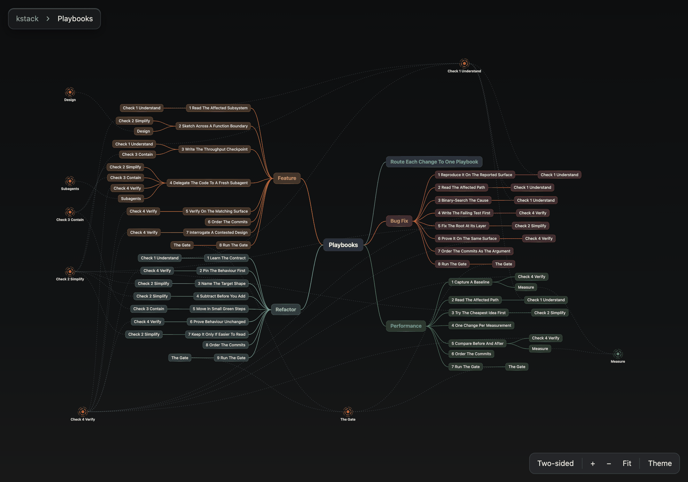

# study

study helps you learn one idea that has many parts, such as a codebase, a skill or a folder of
notes. It turns that idea into an interactive mind map on one HTML page and opens the page beside
the chat. Claude then walks you through the map one part at a time, writes short cards that
explain its parts, and quizzes you on them.

## Run it

Type `/study` and a folder, a file or a skill, or ask Claude to study or map something. Claude runs
every command. study needs uv, a tool that runs Python scripts. If uv is missing, Claude asks once
before it installs it.

- In Claude Code, the map opens in the Browser pane, the browser panel beside the chat in the
  Claude desktop app.
- In Cowork, the Claude desktop app's mode for work on your own files, the folder must be
  connected. The scripts run on your Mac, and Claude publishes the map as an artifact, a page that
  opens in the app's side panel.

study keeps maps and cards in a `.study/` folder. In a git repository the folder is at the top of
the work tree, and outside git it is in the folder you mapped. Git ignores the folder, so maps and
cards are never committed.

## Read the map

The map starts from a centre box. A box and everything under it is a branch, and a box at the end
of a branch is a tip.

- **Open boxes.** Click a box to open one level under it, and click it again to close it.
  Cmd-click a box to open or close every level under it. Use Ctrl-click if you are not on a Mac.
- **Read cards.** Hold the pointer over a box to light the path from the centre to it. If Claude
  has written a card for that box, the card opens beside it. Only tips get cards.
- **Follow links.** Some parts come up in more than one place, such as a check that several steps
  run. The part has one box of its own, and each other place that names it gets a small box with a
  link to that box. A link is a faint dotted line. Hold the pointer over a box, and the links on
  its path turn solid and move.
- **Move between maps.** A stacked box is a portal, and clicking it opens that branch's own map.
  When a link leads to a part on another map, it ends at a round portal at the map's edge.
  Clicking that portal opens the other map and shows the part.
- **Go back.** The breadcrumb at the top lists the maps from the top one down to yours. Click a
  name to go back up, or use the browser's Back button. Each map keeps the boxes you had open.

The bar at the bottom has the other controls. The page remembers your layout and theme.

- **Two-sided** spreads the branches on both sides of the centre box, and **One-sided** puts them
  all on the right.
- **+** and **−** zoom. You can also scroll or pinch to zoom, and drag to move the map.
- **Fit** fits the map to the window.
- **Theme** switches between light and dark.

## Learn from the map

**Walkthrough.** When the map opens, Claude names its top branches and waits for you to pick one.
Claude reads the source of each part before explaining it. It explains the branch from the top
down, one level at a time, and says which box to click next. After a few parts it stops, and it
moves on only when you say so. Claude writes the walkthrough to sound right with **Read aloud**,
the Claude app's button that reads a reply out, so it uses plain talk and no lists or symbols.
Links to the source files come after the spoken part. When the source can't answer a question,
Claude says so.

**Cards.** Ask for cards on a map or a branch, and Claude writes one card for each tip. A card is
3 to 5 short lines, written from the source, and it makes sense without the walkthrough. study
saves cards and shows them again every time it rebuilds the map. A card stays as written until you
ask Claude to rewrite it. If a box is renamed, Claude tells you and offers to move its card.

**Quizzes.** A quiz covers one branch. Every question comes from that branch's tips and cards, and
nothing else. For code, the questions ask what a part does or why it exists, never about syntax.
The wrong options come from the tips next to the right one, so you have to tell similar parts
apart.

- In Claude Code, Claude asks sets of 4 multiple-choice questions, and you can answer in your own
  words too. After each set you get your results. Claude asks the questions you missed again, in
  new words, until you miss none.
- In Cowork, Claude shows a quiz card of 5 questions, each with an explanation. Ask to review and
  the card opens as flashcards.
- Ask to be quizzed out loud, and Claude asks one question at a time with no options. When you are
  unsure, guess. A skip counts as a miss.

Claude gives the right answer after a miss, because practice tests help more with feedback. It
asks for a guess when you are unsure, because studies of word pairs found that a wrong guess helps
when the cue points toward the answer. Applying that to quiz questions is a judgment call
([`references/evidence.md`](references/evidence.md)). Claude never saves the questions or your
results, so you can't learn saved questions by heart.

## How study builds a map

You tell study what to map: a folder, a file or a skill. Scripts do the work that gives the same
result every time, and Claude does the work that needs judgment.

- **Code.** A script outlines Python and JavaScript as folders, files, classes, functions and
  methods.
- **A skill, notes or other Markdown.** Claude reads every file and writes the outline by its
  sections. Where the notes hold code, Claude adds the script's outline of that code as a branch.
- **The page.** A script checks the outline and builds the page. A map of more than 500 boxes is
  split into smaller maps, one inside another.

Claude writes the outline of prose, the cards, the walkthrough and the quiz questions.

## A sample: kstack mapped by study

This is the map study made of this repository, in dark mode. It shows Playbooks, the smaller map
inside build, with every level open.

To try it, download [`examples/kstack-map.html`](examples/kstack-map.html) and open it in a
browser. GitHub shows the file as source code, so the map does not run there. To get the view
above, click build, then the Playbooks portal, then Cmd-click the centre box twice. Use Ctrl-click
if you are not on a Mac.
