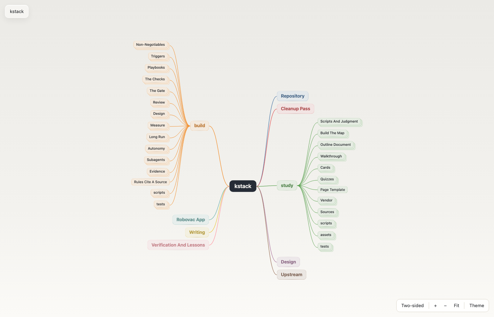
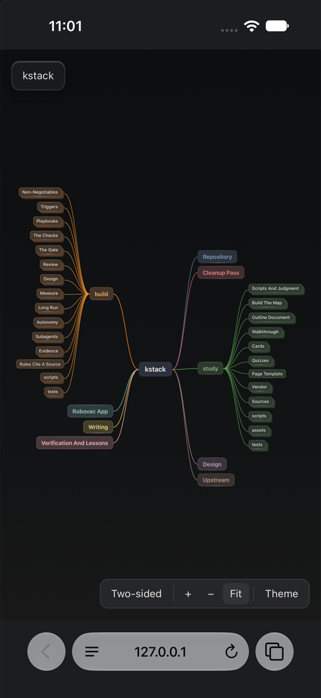

# study

study turns one scope (a folder of code, a skill or a set of notes) into an interactive mind map
on a single HTML page, and opens it beside the chat. Click a box to open its branch. Each tip
gets a hover card once study writes cards for it. A row of small triangles runs from each mention
of a shared piece to its home. When the home is on another map, the row ends at a round vortex
portal on the map's rim, because study splits a big tree into nested maps behind portals.

With the map open, ask study to walk you through a branch, write hover cards for it, or quiz you
on it.

## A sample: kstack mapped by study

This is the map study built of this repository. It has nine top branches, and in these
screenshots the build and study branches are open. The sample has no hover cards yet.

To try it, download [`examples/kstack-map.html`](examples/kstack-map.html) and open it in a
browser. GitHub shows an HTML file as source, so the map does not run from GitHub's page. The
page holds everything it needs in one file of about 0.8 MB.

## Run it

Type `/study <scope>`, where the scope is a folder, a file or a skill, or ask Claude to study or
map something. Claude runs every command. In Cowork, the scope must be in a connected folder, and
study publishes the map as an artifact.

## Where maps live

study keeps maps and cards in a `.study/` folder. In a git repository that folder is at the top
of the work tree. Outside git it is in the studied folder. study writes a `.study/.gitignore` that
keeps the folder out of git, so maps are never committed.
